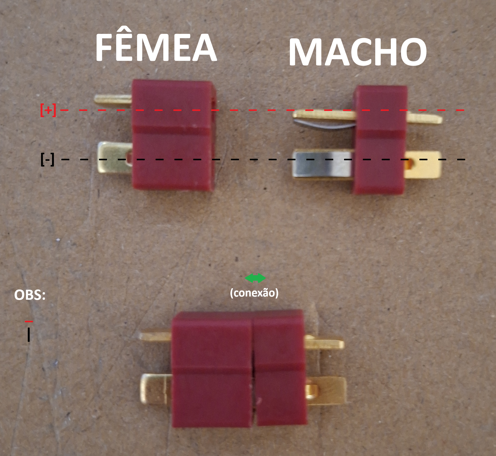
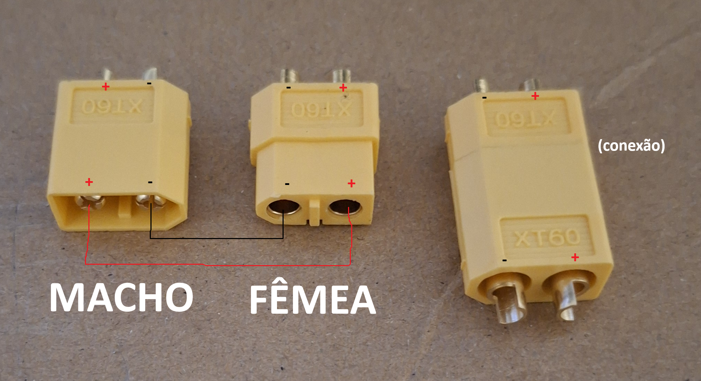

# Sodlering notes for XT60 / T Dean

## Both

Female connector is always at the battery (why?)

To solder:

1. Tin the connecting wires
2. Tin the connector ends
3. Place the thermoplastic on the wires but far from soldering zone
4. For each end (+ and -), 'melt' tinted wire and connector together
5. Move the thermoplastic over solded connection
6. Melt the termoplastic

## T-Dean

Yes it is hard to connect and disconnnect them together, specially
on first time.

## XT60

